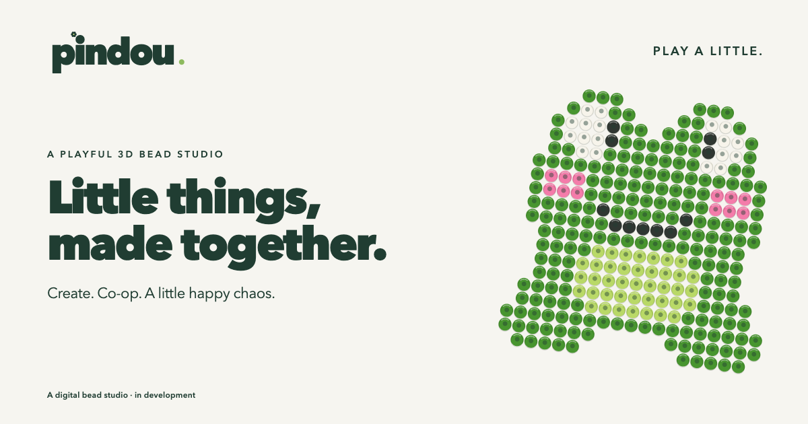

# PinDou



[Brand guide](docs/brand/BRAND-GUIDE.md) · [Instagram + TikTok kit](docs/brand/SOCIAL-PLAYBOOK.md) · [Download social graphics](public/brand/social)

A playful, local-first 3D fuse-bead studio built from the supplied product brief. This implementation delivers the first working creation milestone, plus original templates, image conversion, fusion, exports, and a physical-product estimate. The studio opens immediately at `/` so the core experience can be tested without an account or external service.

**This is a functional creation MVP, not a live commerce service.** Paid-call account, subscription and voice/video integration code is available but requires provider setup and live integration testing. Cloud artwork sync, public galleries, physical-product checkout, order fulfilment, and admin production workflows are not implemented yet. There is no fake checkout or payment-success state. The “Make it real” flow provides an estimate and an immutable downloadable production brief.

## Open in VS Code

Clone this repository or choose **File → Open Folder** and select your PinDou folder. From the integrated terminal, run the install and development commands below. This repository contains source code; GitHub does not host the playable co-op server.

## Run locally

Use Node.js 22+ and pnpm 11 (the lockfile pins the tested dependency resolution).

```sh
pnpm install
pnpm dev
```

Open <http://localhost:3000>. No API keys are needed for the current application. `npm run dev` also works after dependencies are installed with pnpm.

```sh
pnpm lint
pnpm typecheck
pnpm test
pnpm build
pnpm start
pnpm test:e2e
```

Browser tests use an isolated Chrome profile through Playwright (`channel: 'chrome'`), so Google Chrome must be installed. They never use your personal Chrome profile. To use Playwright's bundled Chromium instead, run `pnpm exec playwright install chromium` and remove `channel` from `playwright.config.ts`.

## Working features

- Live WebGL pegboard, shared hollow bead geometry, bevels, plastic materials, instanced beads and pegs, shadows, hover preview, and short placement animation.
- 16×16, 24×24, 29×29, 32×32, and 48×48 boards. The validated logical model supports rectangular boards up to 64×64.
- Pencil, right-click erase, eraser, eyedropper, connected fill, line, rectangle, mirror, rectangular selection, arrow-key selection movement, clear, undo and redo.
- Shared co-op rooms: invitation links, live board edits, named peer cursors, movable bead boxes, spills and tidying, reconnection with queued changes, and conflict-aware undo.
- Grab tool (G) moves and swaps existing beads. Drag from trays or any palette color to a peg, or click to pick up and click to place; Escape puts a bead back. Box handles support dragging and arrow keys.
- Drag strokes form one history operation. History stores only changed cells and is capped at 100 operations.
- Top, isometric and orbitable 3D views, zoom, middle-mouse/space panning, touch painting and two-finger camera gestures.
- 36 named colors, recent colors, project color quantities and CSV bill of materials.
- Debounced local autosave, rename, saved-project library, duplication, export/import project JSON, and PNG share-card export.
- Twelve original templates, category/search filters, guided pattern play, a date-selected daily pattern, and random inspiration.
- Local PNG/JPEG/WEBP conversion using a center-square crop, LAB color matching, selectable board and palette sizes, white-background removal, and contrast adjustment.
- Stylized fusion, editable finished designs, art/keychain/magnet/frame configurations, SGD estimates, disconnected-section detection, and a downloadable snapshot containing pattern, BOM, configuration and estimate.
- Motion preferences, optional synthesized sound, keyboard shortcuts, named color controls, visible focus, modal focus containment, and a coordinate-based alternative to mouse placement.
- Responsive desktop and mobile layouts. Offline editing works while the loaded app remains open; this is not yet an installable/offline-cache PWA.

## Routes

| Route | Purpose |
| --- | --- |
| `/` | Studio with an original frog starter, or the last saved project |
| `/create` | New project/mode selection |
| `/create/[projectId]` | Saved local project editor |
| `/room/[roomId]` | Shared live co-op table |
| `/presets` | Original template library and guided play |
| `/account/projects` | Device-local projects, duplicate, export and delete |

`/create` project URLs are device-local identifiers. Use **Create co-op room → Open shared table → Invite friend** for live collaboration, or export PNG/JSON to take a project to another device.

### Playing with a friend

Keep the server running. On localhost, invitations use the first private LAN IPv4 address detected on the host, so a friend on the same Wi-Fi can open the link. If a VPN or multiple adapters select the wrong address, replace the hostname with this computer’s Wi-Fi IP. Allow the Node server through the OS firewall if prompted. A remote friend needs a publicly reachable deployment; localhost/LAN links do not work across the internet.

Anyone with the random 192-bit invitation link can edit; there are no accounts, ownership roles or moderation controls in this version. Rooms live in a bounded **single Node process**, expire after 12 hours of inactivity, and disappear on server restart. Each participant also autosaves the artwork locally; exports and “Leave with your own copy” preserve it. Trays are transient room toys, not part of project exports. Pending offline changes remain queued only while that page stays open.

The server applies bounded, schema-validated cell and toy operations atomically, with per-client sequence receipts for idempotent retries. Stale conflicting gestures are rejected with a visible notice, and clients retain newer local changes while reconciling snapshots. Sync polls every 250 ms, uses an 8-second request timeout, and retries after 1.5 seconds. Undo skips an entire gesture when another participant has changed one of its affected cells; it cannot partially undo a bead swap. No room providers or keys are required.

## Architecture

```text
app/                     Next.js App Router pages and design-system styles
components/editor/       Studio shell, tool rail, palette, dialogs and workflows
components/three/        WebGL geometry, instancing, camera and pointer interaction
components/library/      Templates and saved projects
components/ui/           Shared header, accessible dialog and grid-derived thumbnails
hooks/                   Storage/connectivity hydration and editor shortcuts
stores/                  Zustand logical editor state and compact history
lib/                     Grid algorithms, palette, original presets, storage,
                         image conversion, exports, motion and central pricing
types/                  Versioned Zod project schema and shared types
tests/                  Unit tests and Playwright user journeys
docs/                   Implementation notes and generated design reference
```

The project stores `{ version, id, name, width, height, cells, createdAt, updatedAt }`, with optional preset and guide fields. Cells contain a color ID or `null`. No Three.js scene state is persisted. JSON imports validate dimensions, palette IDs and timestamps.

Guest projects use the versioned `pindou.projects.v1` localStorage key. Autosave runs 700 ms after the latest completed edit and flushes on page exit. Storage failures remain visible, and exports provide a backup path. Clearing browser storage removes local work, so export important projects.

### 3D and performance

Beads reuse one lathed hollow-cylinder geometry and an instanced physical material. Pegs are another instanced mesh. An external Zustand subscription updates changed instance matrices/colors without rebuilding geometry. Placement animation is capped during rapid painting; an on-demand render loop avoids rendering continuously when idle. Camera fitting accounts for the projected board corners. There is no claim of a measured 60 FPS across all hardware; the 48×48 logical workflow is tested, and real-device profiling remains appropriate before release.

### Animation ownership

- Three.js owns camera positions and scene-object matrices.
- GSAP owns page-entrance wrapper positioning/opacity and cleans up through its context.
- Anime.js owns inner tool/color press scaling.
- CSS owns hover colors, shadows and the isolated fusion-light overlay.

Motion preferences and `prefers-reduced-motion` suppress decorative movement. No animation libraries compete for the same element's transform.

### Pricing and production

`lib/pricing.ts` is the single estimate configuration. All amounts are integer SGD cents; material counts derive from cells. Accessory, packaging, handling, shipping and minimum-order adjustments are explicit. `orderSnapshot()` deep-copies the project, BOM and configuration so subsequent edits do not change the exported brief.

These physical-product prices are **estimates only**. There is no physical-product checkout; Plus subscriptions use a configured server-side Stripe Price. Structural analysis currently detects connected groups and fragile endpoints; it is not a physical-strength guarantee or a full articulation-point/bridge analysis.

## Environment variables and provider setup

Set `NEXT_PUBLIC_APP_URL` to your public origin when hosting so link-preview images use the correct URL. The billing and call variables enable Plus only after the database migration and provider setup in [the hosting guide](docs/COOP-HOSTING.md). Cloud artwork saves and physical-product checkout remain future work.

| Variable | Use |
| --- | --- |
| `NEXT_PUBLIC_SUPABASE_URL` | Supabase project URL |
| `NEXT_PUBLIC_SUPABASE_ANON_KEY` | Public browser key with RLS |
| `SUPABASE_SERVICE_ROLE_KEY` | Server-only administration/webhook operations |
| `NEXT_PUBLIC_STRIPE_PUBLISHABLE_KEY` | Public Stripe key if a client SDK is needed |
| `STRIPE_SECRET_KEY` | Server-only test-mode Checkout creation |
| `STRIPE_WEBHOOK_SECRET` | Verified payment webhook signatures |
| `NEXT_PUBLIC_APP_URL` | Public origin for metadata, invitations and billing redirects |
| `STRIPE_PLUS_PRICE_ID` | Fixed recurring monthly Plus price |
| `DAILY_API_KEY` | Server-only private voice/video room creation |

Never expose service-role or Stripe secret keys through `NEXT_PUBLIC_*` names or commit real `.env` files.

### Supabase and database phase

A private billing/call migration is provided in `supabase/migrations/202609280001_paid_calls.sql`; it has not been applied to a hosted database. The next backend phase should introduce `profiles`, `projects`, `project_versions`, `presets`, `preset_categories`, `bead_colors`, `orders`, `order_status_history`, `pricing_settings`, `inventory`, `favorites`, `achievements`, `user_achievements`, and `daily_challenges`. Use UUID identifiers, versioned logical-grid JSONB, private-by-default project storage, and RLS for owner/admin permissions. Obtain user identity from a validated server session; never trust a client-supplied role. Public project reads must be deliberate. Thumbnails belong in access-controlled Supabase Storage buckets.

### Physical-product Stripe phase

Implement authenticated server-side Checkout Sessions only after cloud project persistence and server pricing are in place. Load the owned project and current pricing server-side, compute totals, store an immutable pending order, and create a test-mode Stripe session. Mark an order paid only after signature-verified, idempotent webhook processing. Do not infer payment success from a redirect. Shipping initially targets Singapore. This phase also needs order timelines, authenticated admin tools, production sheets, inventory and pricing management.

## Deployment

For co-op, deploy `pnpm build` + `pnpm start` on one persistent Node.js server behind HTTPS. The room registry is process-local: do not deploy the current room API to stateless/serverless functions or multiple workers/replicas. Those environments require a shared durable store plus cross-worker synchronization before co-op is reliable. The static/local editor can still be hosted using normal Next.js hosting. Changing the origin creates a separate browser-storage namespace. For paid-call setup and current cost estimates, see [Co-op hosting and calls](docs/COOP-HOSTING.md).

## Validation and remaining work

Validation includes TypeScript, lint, production build, unit tests, and Playwright journeys. The co-op suite opens two isolated browsers using the actual LAN invitation, places and moves beads, shares box movement/spills, reconnects after offline changes, and checks closed-room recovery. The test suite covers grid/line/rectangle/fill behavior, non-wrapping adjacency, compact history, mirrored strokes, color replacement, selection movement, 2,304-cell fill, BOM, structural groups, schema validation, image mapping, integer pricing and snapshot immutability. Playwright covers the main editor journey, template/fusion/estimate/export flow, duplication, and layout widths of 375, 390, 430, 768, 1024, 1440 and 1920 px.

Remaining brief features include the dedicated animated landing page, cloud project persistence, physical-product Stripe checkout, public gallery/sharing, admin/production/order routes, configurable masks, manual crop and before/after image controls, dithering, complete achievements, richer completion celebrations, keyring positioning, and deeper structural validation. These are intentionally not presented as complete.

Design reference: `docs/studio-concept.png`, generated with the built-in Image Gen tool. The implementation uses live Three.js artwork and data-derived SVG thumbnails, not the raster concept as UI. The compact studio-first entry, extra selection/move tools, real saved-state wording, and settings control are intentional implementation differences.

### Paid voice/video beta

One Plus member hosts; friends join free. The new `/account/plus` flow uses Supabase email OTP, Stripe hosted Checkout/portal, verified subscription webhooks, and private Daily calls. The default proposed allowance is five 30-minute sessions per UTC month with up to four participants. Calls remain disabled until all provider settings and the migration are installed. See [setup, costs and remaining launch checks](docs/COOP-HOSTING.md).
